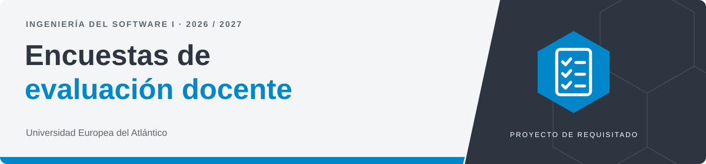

  

# Encuestas de evaluación docente

Proyecto de requisitado de **Ingeniería del Software I · Curso 2026–2027**. Documentación elaborada a partir de la primera reunión con el cliente, celebrada el **26/10/2026**.

En esta página

-  El proyecto
-  Explorar la documentación
-  Estado de los entregables
-  Próximos pasos y referencias
-  Equipo
-  Estructura del repositorio
-  Flujo de trabajo

## El proyecto

El sistema automatiza las encuestas semestrales de satisfacción docente. Cada estudiante elegible recibe las evaluaciones de los profesores que le han impartido cada asignatura. La participación es voluntaria y las respuestas son anónimas. El cuestionario contiene 11 ítems obligatorios, puntuados del 1 al 5, y un campo opcional de observaciones.

El administrador fija las fechas de la convocatoria. El sistema avisa por el campus virtual y por correo, conserva cada evaluación enviada y publica los resultados al cierre. Los resultados se separan por grado y se pueden exportar a PDF o Excel. La integración con el entorno universitario se plantea como una simulación. [Minuta de la sesión 01](documentos/sesiones/sesion01.md#notas-de-la-sesión-del-26-10-2026)

## Explorar la documentación

| Sesiones con el cliente | Modelo del dominio | Actores y casos de uso |
| :--- | :--- | :--- |
| Preguntas, minuta y cuestionario de la primera reunión. | Conceptos, glosario, escenarios y reglas trazadas a la minuta. | Catálogo de negocio, refactor v3 y diagramas de contexto. |
|  |  |  |

**Ruta de lectura:** minuta → modelo del dominio y reglas → actores y casos de uso. Las decisiones propuestas se distinguen de lo confirmado por el cliente.

## Estado de los entregables

Estado documental tras la sesión 01 y la integración del refactor del issue #22 en `develop`. La integración en Git no implica validación del cliente.

| Entregable | Estado | Consultar |
| :--- | :--- | :--- |
| Minuta de la sesión 01 | Documentada |  |
| Modelo del dominio v3 | Documentado; pendiente de validación con el cliente |  |
| Glosario y escenarios | Documentados como parte del modelo v3 |  |
| Reglas y decisiones | Trazadas a la minuta; supuestos identificados |  |
| Actores y casos de uso v3 | Refactor integrado; propuestas pendientes de validar |  |
| Diagramas de contexto | Gestor y Alumno integrados |  |
| Priorización de casos de uso | Pendiente de acordar con el cliente | — |
| Detallado y criterios de aceptación | Pendientes para los casos priorizados | — |
| Prototipado de casos de uso | Pendiente para validar los flujos | — |

## Equipo

| Integrante                | GitHub                                                         |
| :------------------------ | :------------------------------------------------------------- |
| Raúl Tascón (coordinador) | [@Raultascon](https://github.com/Raultascon)                   |
| Adrián Solar              | [@adriansolar](https://github.com/adriansolar)                 |
| Carlos Valdés Barquín     | [@carlosvaldesbarquin](https://github.com/carlosvaldesbarquin) |
| Diego Alonso Díaz         | [@Diego-alonsodiaz](https://github.com/Diego-alonsodiaz)       |
| Diego Arellano            | [@DiegoArellano30](https://github.com/DiegoArellano30)         |
| Héctor Ares Ibáñez        | [@hectorares3](https://github.com/hectorares3)                 |
| Marcos González Hidalgo   | [@mglezz](https://github.com/mglezz)                           |

## Flujo de trabajo

1. Registrar cada tarea en un issue y enlazar las decisiones debatidas en Discussions.
2. Trabajar en una rama por issue desde `develop`: `tipo/issue-N-descripcion`. Referenciar el issue en los commits con `[refs #N]`.
3. Revisar mediante pull request hacia `develop`, con al menos una aprobación de otro integrante. Integrar en `main` mediante pull request desde `develop`.
4. Vincular los artefactos a la minuta y registrar la asistencia con IA y su revisión humana.

Identidad visual y procedencia

Paleta inspirada en las capturas de Panal aportadas por el equipo: azul `#0086C9`, pizarra `#2C3540`, gris claro `#F3F5F6` y blanco. Los SVG de `documentos/recursos/` son recursos propios de este proyecto académico; la marca de encuesta no es un logotipo oficial de la universidad. La navegación visual y las vistas de diagramas toman como referencia la organización de Jorgestor.

---

Ingeniería del Software I · UNEATLANTICO · 2026–2027

