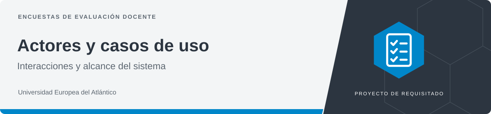
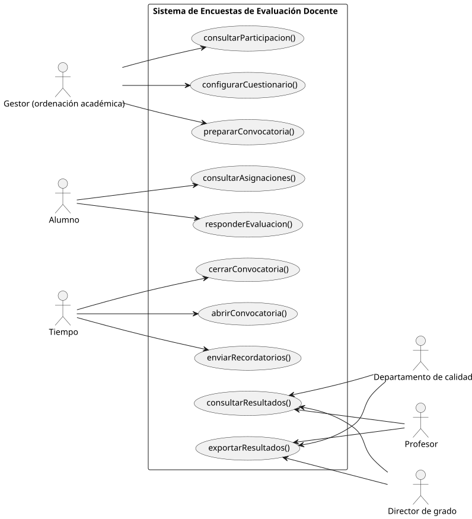
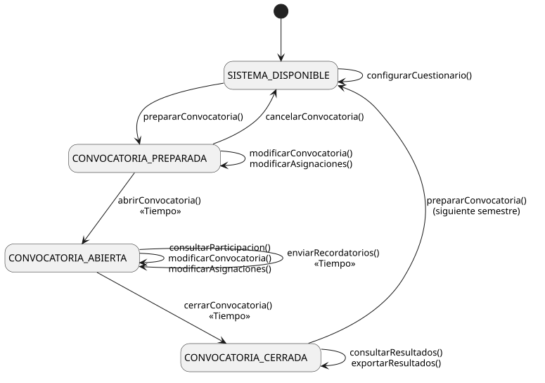
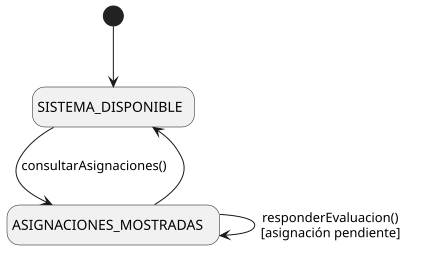

<p align="center">
  
</p>

<p align="center">
<a href="../../README.md"></a>
<a href="../../documentos/sesiones/README.md"></a>
<a href="../../documentos/modelos/README.md"></a>
<a href="../../documentos/casos-uso/README.md"></a>
<a href="../../documentos/modelos/documentacion/glosario.md"></a>
<a href="../../documentos/AI-uso.md"></a>
</p>

# Casos de uso · Guía de lectura

Documentación de actores y casos de uso del sistema de encuestas. La propuesta vigente es el **refactor v3 del issue #22**, integrado en `develop`; el documento conserva la v2 original y explica los cambios en una sección propia.

<details>
<summary>En esta página</summary>

- <a href="#orden-de-lectura"></a> Orden de lectura
- <a href="#actores-y-casos-de-uso-v3"></a> Actores y casos de uso v3
- <a href="#diagramas-de-contexto"></a> Diagramas de contexto
- <a href="#versiones-y-seguimiento"></a> Versiones y seguimiento
- <a href="#organización-de-la-carpeta"></a> Organización de la carpeta

</details>

## Orden de lectura

| Paso | Contenido | Acceso |
| :--- | :--- | :--- |
| 1 | Refactor v3 y cambios respecto a v2 | <a href="documentacion/actores-casos-uso.md#refactor-v3-issue-22"></a> |
| 2 | Actores y catálogo de casos de uso v3 | <a href="documentacion/actores-casos-uso.md#catálogo-de-casos-de-uso-v3"></a> |
| 3 | Glosario de actores y casos de uso | <a href="documentacion/actores-casos-uso.md#glosario-de-actores-y-casos-de-uso"></a> |
| 4 | Trazabilidad y exclusiones del dominio | <a href="documentacion/actores-casos-uso.md#trazabilidad-y-exclusiones-del-dominio-v3"></a> |
| 5 | Asistencia con IA en v1, v2 y v3 | <a href="../AI-uso.md#actores-y-casos-de-uso-v1-y-v2"></a> |

## Actores y casos de uso v3

<a href="diagramas/actoresCasosUso.svg"></a>

<a href="diagramas/actoresCasosUso.svg"></a> <a href="diagramas/actoresCasosUso.puml"></a>

El rol abstracto `ConsultorResultados` agrupa los roles de consulta. Campus Virtual / Panal figura como actor secundario. Los roles de Director de grado y Departamento de calidad y las operaciones de gestión propuestas siguen sujetos a confirmación del cliente, como indica el documento del refactor.

## Diagramas de contexto

| Gestor | Alumno |
| :---: | :---: |
| <a href="diagramas/diagramaContexto-gestor.svg"></a> | <a href="diagramas/diagramaContexto-alumno.svg"></a> |
| <a href="diagramas/diagramaContexto-gestor.svg"></a> <a href="diagramas/diagramaContexto-gestor.puml"></a> | <a href="diagramas/diagramaContexto-alumno.svg"></a> <a href="diagramas/diagramaContexto-alumno.puml"></a> |

## Versiones y seguimiento

| Versión | Contenido | Diagrama | Fuente |
| :--- | :--- | :--- | :--- |
| v1 · Issue #15 | Asociaciones directas | <a href="historico/v1/actoresCasosUso-v1.svg"></a> | <a href="historico/v1/actoresCasosUso-v1.puml"></a> |
| v2 · Issue #15 | Generalización desde Profesor, conservada como referencia | <a href="historico/v2/actoresCasosUso-v2.svg"></a> | <a href="historico/v2/actoresCasosUso-v2.puml"></a> |
| v3 · Issue #22 | ConsultorResultados, Panal y gestión de campaña | <a href="diagramas/actoresCasosUso.svg"></a> | <a href="diagramas/actoresCasosUso.puml"></a> |

Seguimiento: [identificación inicial · #15](https://github.com/Raultascon/26-27-IdSw1-SDR/issues/15), [refactor · #22](https://github.com/Raultascon/26-27-IdSw1-SDR/issues/22) e [integración · PR #24](https://github.com/Raultascon/26-27-IdSw1-SDR/pull/24).

## Organización de la carpeta

```text
casos-uso/
├── README.md        Guía de lectura y accesos
├── documentacion/   Identificación v2 y refactor v3 con registro de cambios
├── diagramas/       Diagramas vigentes: fuente PUML e imagen SVG juntas
└── historico/       Iteraciones v1 y v2 conservadas como referencia
```

La priorización, el detallado con criterios de aceptación y el prototipado están pendientes. Se abordarán a partir de los casos acordados con el cliente.

---

<p align="center">
<a href="../../README.md"></a>
<a href="../../documentos/CONVENCIONES.md"></a>
<a href="../../documentos/AI-uso.md"></a>
<a href="#"></a>
</p>

<p align="center"><sub>Ingeniería del Software I · UNEATLANTICO · 2026–2027</sub></p>
