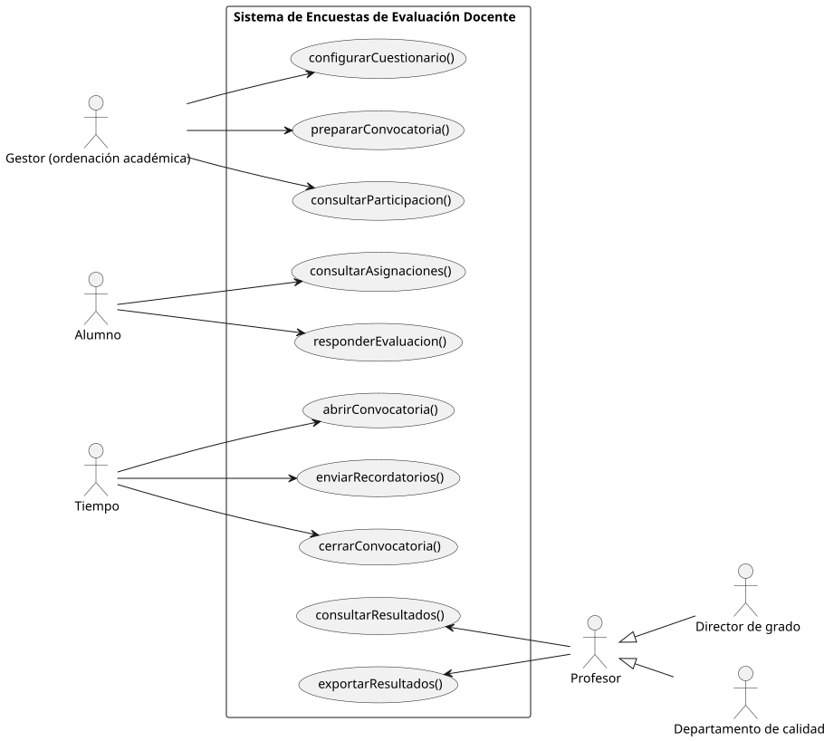
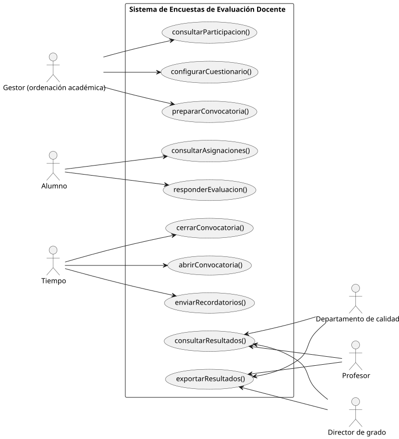
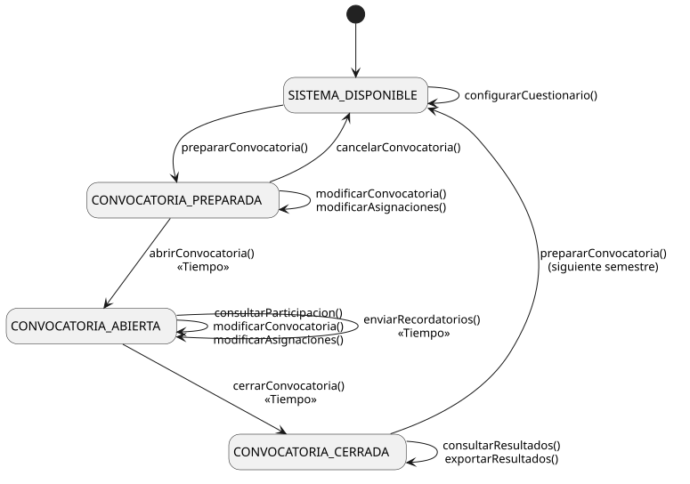
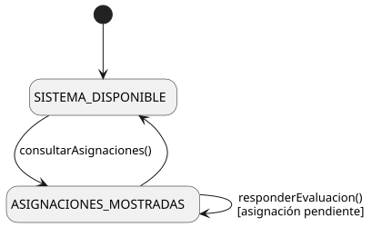

# Encuestas de Evaluación Docente - Actores y casos de uso

[Modelo del dominio v3](../../modelos/documentacion/dominio-v3.md) · [Minuta sesión 01](../../sesiones/sesion01.md)

> **Estructura del documento.** La primera parte conserva sin cambios la versión `v2` elaborada en el [Issue #15](https://github.com/Raultascon/26-27-IdSw1-SDR/issues/15) (solo se han actualizado las rutas de sus diagramas, que ahora están en `historico/`). La versión vigente es el [Refactor `v3`](#refactor-v3-issue-22), al final del documento, con el registro de cambios.

## Información del artefacto

- **Proyecto**: Sistema de Encuestas de Satisfacción del Profesorado (`26-27-IdSw1-SDR`)
- **Disciplina**: Requisitos · Identificación de actores y casos de uso (`v1` y `v2`)
- **Fecha**: 2026-11-23
- **Autor**: Diego Alonso Díaz ([Issue #15](https://github.com/Raultascon/26-27-IdSw1-SDR/issues/15))

## Introducción y criterios de modelado

Este documento define los actores externos y el catálogo inicial de casos de uso del sistema a partir de los requisitos recogidos en la [sesión 01 (26/10/2026)](../../sesiones/sesion01.md) y las entidades del [Modelo del dominio v3](../../modelos/documentacion/dominio-v3.md).

Para garantizar la rigorosidad metodológica de esta fase se aplican tres reglas:
1. **Actores fuera de la frontera del sistema**: Todos los actores (humanos, organizativos o temporales) se sitúan fuera del límite del sistema, representando únicamente entidades externas que inician o participan en una interacción.
2. **Nivel de abstracción de negocio**: Los casos de uso expresan objetivos funcionales del dominio sin mezclar acciones de navegación o interfaz (como apertura de pantallas o listados CRUD técnicos), que corresponden a iteraciones posteriores de refinamiento.
3. **Sin relaciones `<<include>>` ni `<<extend>>`**: Cada caso de uso representa una interacción directa y autónoma entre actor y sistema.

## Actores identificados

| Actor | Tipo | Descripción | Responsabilidades principales |
| :--- | :---: | :--- | :--- |
| **Gestor (ordenación académica)** | Humano / Organizativo | Responsable operativo de la gestión administrativa de las campañas de evaluación docente. | Configurar la plantilla fija del cuestionario |
| | | | Planificar la convocatoria semestral y generar las asignaciones |
| | | | Supervisar el nivel global de participación sin comprometer el anonimato |
| **Alumno** | Humano | Estudiante matriculado en docencias del semestre (excluyendo alumnos ERASMUS+ de la asignación). | Consultar sus docencias asignadas (pendientes y enviadas) |
| | | | Cumplimentar y enviar de forma individual y anónima cada evaluación |
| **Tiempo** | Temporal | Disparador automático del sistema regido por el calendario de la convocatoria. | Activar la convocatoria en su fecha de apertura y notificar a los alumnos |
| | | | Enviar recordatorios recurrentes mientras el plazo sigue abierto |
| | | | Cerrar la convocatoria en la fecha límite y publicar los resultados |
| **Profesor** | Humano | Docente impartidor evaluado en cada asignatura y grado en el que participa. | Consultar las medias por ítem, media global, número de valoraciones y comentarios de sus docencias tras el cierre |
| | | | Exportar los resultados consolidados de sus docencias |
| **Director de grado** | Humano / Organizativo | Responsable académico de una titulación concreta. | Consultar los resultados consolidados segmentados por su grado |
| | | | Exportar los informes de resultados de su titulación |
| **Departamento de calidad** | Organizativo | Unidad institucional encargada del aseguramiento de la calidad docente. | Consultar los resultados consolidados globales de toda la convocatoria |
| | | | Exportar los informes institucionales para evaluación de calidad |

### Decisiones sobre el alcance de actores

- **Alumnos ERASMUS+**: No se modelan como un actor separado; son instancias de **Alumno** (`Estudiante` con `esErasmus = true` en el modelo del dominio) a las que no se les generan asignaciones de evaluación.
- **Campus Virtual / Panal**: Actúa como entorno universitario de integración y autenticación, sin constituir un actor con objetivos de negocio propios en esta fase.

## Diagramas de actores y casos de uso

### Iteración 1 (`v1`) · Asociaciones directas

Primera identificación plana donde cada actor se conecta directamente con los casos de uso en los que interviene.

| Actores y casos de uso · v1 |
| :-: |
|  |
| Código fuente: [actoresCasosUso-v1.puml](../historico/v1/actoresCasosUso-v1.puml) |

### Iteración 2 (`v2`) · Generalización de roles de consulta

Refinamiento estructural aplicando **herencia entre actores (`--|>`)**: dado que **Profesor**, **Director de grado** y **Departamento de calidad** ejecutan las mismas operaciones funcionales de consulta y exportación tras el cierre, **Director de grado** y **Departamento de calidad** heredan las asociaciones de **Profesor**, eliminando el cruce de líneas y diferenciándose únicamente por el ámbito de visibilidad de los datos (docencia, grado o institución).

| Actores y casos de uso · v2 |
| :-: |
|  |
| Código fuente: [actoresCasosUso-v2.puml](../historico/v2/actoresCasosUso-v2.puml) |

## Catálogo de casos de uso

### Resumen por actor

| Actor | Casos de uso asociados |
| :--- | :--- |
| **Gestor (ordenación académica)** | `configurarCuestionario()`, `prepararConvocatoria()`, `consultarParticipacion()` |
| **Alumno** | `consultarAsignaciones()`, `responderEvaluacion()` |
| **Tiempo** | `abrirConvocatoria()`, `enviarRecordatorios()`, `cerrarConvocatoria()` |
| **Profesor** *(rol base de consulta)* | `consultarResultados()`, `exportarResultados()` |
| **Director de grado** *(hereda de Profesor)* | `consultarResultados()`, `exportarResultados()` *(ámbito: titulación)* |
| **Departamento de calidad** *(hereda de Profesor)* | `consultarResultados()`, `exportarResultados()` *(ámbito: institución)* |

### Descripción funcional a nivel de negocio

#### Gestión de campaña (Gestor)
- **`configurarCuestionario()`**: Define o revisa la plantilla común de 11 ítems numéricos obligatorios (escala 1–5) y el enunciado de observaciones opcionales antes de activar la convocatoria.
- **`prepararConvocatoria()`**: Crea la convocatoria semestral fijando `fechaApertura` y `fechaCierre`, vincula el cuestionario común y genera las `AsignacionEvaluacion` para los alumnos elegibles (excluyendo alumnos ERASMUS+).
- **`consultarParticipacion()`**: Consulta el recuento y porcentaje de evaluaciones enviadas frente a asignadas para supervisar el desarrollo de la campaña sin vincular identidad con respuestas.

#### Participación estudiantil (Alumno)
- **`consultarAsignaciones()`**: Muestra al alumno sus docencias asignadas en la convocatoria activa (diferenciando cada combinación de profesor y asignatura), distinguiendo las pendientes de las ya enviadas.
- **`responderEvaluacion()`**: Permite cumplimentar los 11 ítems obligatorios (escala 1–5) y las observaciones opcionales de una docencia pendiente, registrando su envío individual anónimo sin posibilidad de edición posterior ni guardado parcial.

#### Automatización temporal (Tiempo)
- **`abrirConvocatoria()`**: Habilita la recepción de evaluaciones al alcanzarse `fechaApertura` y emite la notificación inicial en el Campus Virtual/Panal y por correo electrónico.
- **`enviarRecordatorios()`**: Emite avisos periódicos en el Campus Virtual/Panal y por correo electrónico a los alumnos que mantienen asignaciones pendientes mientras el plazo sigue abierto.
- **`cerrarConvocatoria()`**: Finaliza el periodo de respuesta al alcanzarse `fechaCierre`, bloquea nuevos envíos y pone los resultados consolidados a disposición simultánea del profesorado, dirección de grado, departamento de calidad y gestión.

#### Consulta y explotación de resultados (Profesor, Director de grado, Departamento de calidad)
- **`consultarResultados()`**: Muestra el número de valoraciones (`N`), las 11 medias por ítem, la media global calculada y los comentarios abiertos tras el cierre, filtrados según el rol: sus docencias para el **Profesor**, su titulación (`Grado`) para el **Director de grado** y la vista global del centro para el **Departamento de calidad**.
- **`exportarResultados()`**: Genera y descarga un informe en formato PDF o Excel con los resultados consolidados y observaciones correspondientes al ámbito del actor solicitante.

## Trazabilidad y exclusiones del dominio

- **Correspondencia con el Modelo del Dominio v3**: Los casos de uso operan directamente sobre `Cuestionario` e `Item` (configuración), `Convocatoria` y `AsignacionEvaluacion` (planificación, participación y notificaciones), y `Evaluacion` y `Puntuacion` agrupadas por `Docencia` y `Grado` (envío anónimo y cálculo de resultados).
- **Comportamientos excluidos explícitamente**: Por requisito expreso del cliente en la [sesión 01](../../sesiones/sesion01.md), no existen casos de uso para eliminar evaluaciones recibidas, censurar observaciones opcionales ni modificar respuestas una vez enviadas.

---

## Refactor v3 (Issue #22)

- **Autor de la revisión**: Adrián Solar ([Issue #22](https://github.com/Raultascon/26-27-IdSw1-SDR/issues/22))
- **Fecha**: 2026-11-24
- **Origen**: mejoras acordadas por el equipo en Discussions tras revisar el PR #19.

### Registro de cambios respecto a v2

| # | Cambio | Motivo | Commit |
| :-: | :--- | :--- | :--- |
| 1 | Diagrama único vigente; v1 y v2 pasan a `historico/`. Actor abstracto `ConsultorResultados` en lugar de heredar de `Profesor`. | El Departamento de calidad no es un profesor ni es evaluado, por lo que la herencia desde Profesor no era correcta. | `d87b04b` |
| 2 | El **Gestor** hereda de `ConsultorResultados` (consulta y exportación de resultados). | `cerrarConvocatoria()` ya ponía los resultados a disposición de gestión y la sesión 01 indica que el administrador ve todas las respuestas. | `5e3b9d5` |
| 3 | **Campus Virtual / Panal** pasa a ser actor secundario. | El sistema obtiene de él los datos académicos y publica en él las notificaciones: interactúa a través de la frontera. | `653e87e`, `b7fa992` |
| 4 | Nuevos casos de uso `modificarConvocatoria()`, `cancelarConvocatoria()` y `modificarAsignaciones()`. | La convocatoria y las asignaciones solo podían crearse, no corregirse. Pendientes de validar con el cliente. | `f522d34` |
| 5 | Diagramas de contexto del Gestor y del Alumno. | Faltaba relacionar los casos de uso entre sí. | `2dac07b` |
| 6 | Glosario de actores y casos de uso. | Definir los términos propios del artefacto sin duplicar el glosario del dominio. | `e6ecbe0` |
| 7 | Corrección del enlace al modelo del dominio v3. | El enlace apuntaba a `modelo-v3.md`, que no existe. | `3b4257f` |

**Descartado por el equipo:** modelar el Servidor de correo como actor (el correo es solo un canal de notificación) y mover los diagramas a `modelosUML` (el resto del repositorio usa `diagramas/`; queda como decisión de grupo).

### Criterio de modelado actualizado

2. **Nivel de abstracción de negocio**: Los casos de uso expresan objetivos funcionales del dominio sin mezclar acciones de navegación o interfaz (como apertura de pantallas), que corresponden a iteraciones posteriores de refinamiento. Sí se incluyen los casos de uso necesarios para crear, modificar y cancelar los objetos de negocio que gestiona cada actor (convocatoria y asignaciones), salvo los excluidos expresamente por el cliente.

### Actores identificados (v3)

| Actor | Tipo | Descripción | Responsabilidades principales |
| :--- | :---: | :--- | :--- |
| **Gestor (ordenación académica)** | Humano / Organizativo | Responsable operativo de la gestión administrativa de las campañas de evaluación docente. | Configurar la plantilla fija del cuestionario |
| | | | Planificar la convocatoria semestral y generar las asignaciones |
| | | | Modificar o cancelar una convocatoria ya preparada y corregir asignaciones |
| | | | Supervisar el nivel global de participación sin comprometer el anonimato |
| | | | Consultar y exportar los resultados consolidados de toda la convocatoria tras el cierre |
| **Alumno** | Humano | Estudiante matriculado en docencias del semestre (excluyendo alumnos ERASMUS+ de la asignación). | Consultar sus docencias asignadas (pendientes y enviadas) |
| | | | Cumplimentar y enviar de forma individual y anónima cada evaluación |
| **Tiempo** | Temporal | Disparador automático del sistema regido por el calendario de la convocatoria. | Activar la convocatoria en su fecha de apertura y notificar a los alumnos |
| | | | Enviar recordatorios recurrentes mientras el plazo sigue abierto |
| | | | Cerrar la convocatoria en la fecha límite y publicar los resultados |
| **Profesor** | Humano | Docente impartidor evaluado en cada asignatura y grado en el que participa. | Consultar las medias por ítem, media global, número de valoraciones y comentarios de sus docencias tras el cierre |
| | | | Exportar los resultados consolidados de sus docencias |
| **Director de grado** | Humano / Organizativo | Responsable académico de una titulación concreta. | Consultar los resultados consolidados segmentados por su grado |
| | | | Exportar los informes de resultados de su titulación |
| **Departamento de calidad** | Organizativo | Unidad institucional encargada del aseguramiento de la calidad docente. | Consultar los resultados consolidados globales de toda la convocatoria |
| | | | Exportar los informes institucionales para evaluación de calidad |
| **Campus Virtual / Panal** | Sistema externo (secundario) | Entorno universitario en el que se integra el sistema. | Proporcionar los datos académicos (alumnos, docencias, condición ERASMUS+) para generar las asignaciones |
| | | | Mostrar las notificaciones y avisos recurrentes a los alumnos |

#### Decisiones sobre el alcance de actores

- **Alumnos ERASMUS+**: No se modelan como un actor separado; son instancias de **Alumno** (`Estudiante` con `esErasmus = true` en el modelo del dominio) a las que no se les generan asignaciones de evaluación.
- **Campus Virtual / Panal**: Se modela como **actor secundario**. No inicia casos de uso, pero el sistema interactúa con él a través de su frontera: obtiene los datos académicos y publica en él las notificaciones y avisos recurrentes.
- **Correo electrónico**: No se modela como actor. La [sesión 01](../../sesiones/sesion01.md) lo establece como canal de notificación junto al campus, pero no aporta objetivos ni datos propios al sistema; se recoge en la descripción de `abrirConvocatoria()` y `enviarRecordatorios()`.

### Diagrama de actores y casos de uso (v3)

Versión vigente (`v3`). Las iteraciones anteriores se conservan en [`historico/`](../historico/) como referencia de la evolución del modelo.

| Actores y casos de uso · v3 |
| :-: |
|  |
| Código fuente: [actoresCasosUso.puml](../diagramas/actoresCasosUso.puml) |

#### Generalización de roles de consulta

**Profesor**, **Director de grado** y **Departamento de calidad** realizan las mismas operaciones de consulta y exportación tras el cierre, pero no son una especialización unos de otros: el Departamento de calidad no es un profesor ni es evaluado. Por ello se introduce el actor abstracto **ConsultorResultados**, que concentra las asociaciones con `consultarResultados()` y `exportarResultados()`, y del que heredan los tres roles. El **Gestor** también hereda de este rol, ya que la minuta indica que el administrador recibe los resultados al cierre y puede ver todas las respuestas. Cada uno se diferencia únicamente por el ámbito de visibilidad de los datos (docencia, grado, institución o convocatoria completa).

#### Evolución

| Versión | Cambio | Diagrama |
| :---: | :--- | :--- |
| `v1` | Identificación plana: cada actor se asocia directamente con sus casos de uso. | [SVG](../historico/v1/actoresCasosUso-v1.svg) · [PUML](../historico/v1/actoresCasosUso-v1.puml) |
| `v2` | Director de grado y Departamento de calidad heredan de Profesor. Descartada: la herencia implicaba que ambos eran profesores. | [SVG](../historico/v2/actoresCasosUso-v2.svg) · [PUML](../historico/v2/actoresCasosUso-v2.puml) |
| `v3` | Actor abstracto ConsultorResultados como rol base de consulta ([Issue #22](https://github.com/Raultascon/26-27-IdSw1-SDR/issues/22)). | Vigente |

### Diagramas de contexto

Relacionan los casos de uso entre sí mediante diagramas de estados: cada estado representa la situación del sistema que percibe el actor y cada transición, el caso de uso que la provoca.

| Gestor · ciclo de vida de la convocatoria | Alumno |
| :-: | :-: |
|  |  |
| [diagramaContexto-gestor.puml](../diagramas/diagramaContexto-gestor.puml) | [diagramaContexto-alumno.puml](../diagramas/diagramaContexto-alumno.puml) |

Las transiciones marcadas con `<<Tiempo>>` las dispara el actor Tiempo según las fechas de la convocatoria; se incluyen en el diagrama del Gestor porque determinan qué casos de uso tiene disponibles en cada momento.

### Catálogo de casos de uso (v3)

#### Resumen por actor

| Actor | Casos de uso asociados |
| :--- | :--- |
| **Gestor (ordenación académica)** *(hereda de ConsultorResultados)* | `configurarCuestionario()`, `prepararConvocatoria()`, `modificarConvocatoria()`, `cancelarConvocatoria()`, `modificarAsignaciones()`, `consultarParticipacion()`, `consultarResultados()`, `exportarResultados()` *(ámbito: toda la convocatoria)* |
| **Alumno** | `consultarAsignaciones()`, `responderEvaluacion()` |
| **Tiempo** | `abrirConvocatoria()`, `enviarRecordatorios()`, `cerrarConvocatoria()` |
| **ConsultorResultados** *(abstracto, rol base de consulta)* | `consultarResultados()`, `exportarResultados()` |
| **Profesor** *(hereda de ConsultorResultados)* | `consultarResultados()`, `exportarResultados()` *(ámbito: sus docencias)* |
| **Director de grado** *(hereda de ConsultorResultados)* | `consultarResultados()`, `exportarResultados()` *(ámbito: titulación)* |
| **Departamento de calidad** *(hereda de ConsultorResultados)* | `consultarResultados()`, `exportarResultados()` *(ámbito: institución)* |

#### Descripción funcional a nivel de negocio

##### Gestión de campaña (Gestor)
- **`configurarCuestionario()`**: Define o revisa la plantilla común de 11 ítems numéricos obligatorios (escala 1–5) y el enunciado de observaciones opcionales antes de activar la convocatoria.
- **`prepararConvocatoria()`**: Crea la convocatoria semestral fijando `fechaApertura` y `fechaCierre`, vincula el cuestionario común y genera las `AsignacionEvaluacion` para los alumnos elegibles (excluyendo alumnos ERASMUS+).
- **`modificarConvocatoria()`**: Cambia las fechas de una convocatoria ya preparada (por ejemplo, retrasar la apertura o ampliar el plazo de respuesta mientras sigue abierta). La [sesión 01](../../sesiones/sesion01.md) establece que es el administrador quien fija la fecha exacta.
- **`cancelarConvocatoria()`**: Anula una convocatoria preparada que aún no se ha abierto, sin generar notificaciones a los alumnos.
- **`modificarAsignaciones()`**: Añade o retira asignaciones de evaluación de forma individual (por ejemplo, un alumno matriculado tarde o una asignación generada por error) sin afectar a las evaluaciones ya enviadas.
- **`consultarParticipacion()`**: Consulta el recuento y porcentaje de evaluaciones enviadas frente a asignadas para supervisar el desarrollo de la campaña sin vincular identidad con respuestas.

##### Participación estudiantil (Alumno)
- **`consultarAsignaciones()`**: Muestra al alumno sus docencias asignadas en la convocatoria activa (diferenciando cada combinación de profesor y asignatura), distinguiendo las pendientes de las ya enviadas.
- **`responderEvaluacion()`**: Permite cumplimentar los 11 ítems obligatorios (escala 1–5) y las observaciones opcionales de una docencia pendiente, registrando su envío individual anónimo sin posibilidad de edición posterior ni guardado parcial.

##### Automatización temporal (Tiempo)
- **`abrirConvocatoria()`**: Habilita la recepción de evaluaciones al alcanzarse `fechaApertura` y emite la notificación inicial en el Campus Virtual/Panal y por correo electrónico.
- **`enviarRecordatorios()`**: Emite avisos periódicos en el Campus Virtual/Panal y por correo electrónico a los alumnos que mantienen asignaciones pendientes mientras el plazo sigue abierto.
- **`cerrarConvocatoria()`**: Finaliza el periodo de respuesta al alcanzarse `fechaCierre`, bloquea nuevos envíos y pone los resultados consolidados a disposición simultánea del profesorado, dirección de grado, departamento de calidad y gestión.

##### Consulta y explotación de resultados (ConsultorResultados: Profesor, Director de grado, Departamento de calidad y Gestor)
- **`consultarResultados()`**: Muestra el número de valoraciones (`N`), las 11 medias por ítem, la media global calculada y los comentarios abiertos tras el cierre, filtrados según el rol: sus docencias para el **Profesor**, su titulación (`Grado`) para el **Director de grado** y la vista global del centro para el **Departamento de calidad** y todas las respuestas de la convocatoria para el **Gestor**, que según la [sesión 01](../../sesiones/sesion01.md) recibe los resultados al cierre junto a los profesores y puede ver todas las respuestas.
- **`exportarResultados()`**: Genera y descarga un informe en formato PDF o Excel con los resultados consolidados y observaciones correspondientes al ámbito del actor solicitante.

### Glosario de actores y casos de uso

Los conceptos del dominio (Convocatoria, Docencia, AsignacionEvaluacion, Evaluacion, etc.) se definen en el [glosario del modelo del dominio v3](../../modelos/documentacion/glosario.md). Aquí solo se recogen los términos propios de este artefacto.

| Término | Significado |
| :--- | :--- |
| **Actor** | Rol externo (persona, sistema o evento temporal) que interactúa con el sistema a través de su frontera. Representa un rol, no a una persona concreta. |
| **Actor secundario** | Sistema externo con el que el sistema interactúa sin que inicie casos de uso: Campus Virtual / Panal. |
| **Gestor (ordenación académica)** | Rol que la [sesión 01](../../sesiones/sesion01.md) denomina **administrador**: fija las fechas, gestiona la campaña y puede ver todas las respuestas. |
| **ConsultorResultados** | Actor abstracto que agrupa a quienes consultan y exportan resultados tras el cierre. No existe por sí mismo; solo se concreta en Profesor, Director de grado, Departamento de calidad o Gestor. |
| **Ámbito de visibilidad** | Subconjunto de resultados al que accede cada ConsultorResultados: sus docencias, su grado, la institución o la convocatoria completa. |
| **Tiempo** | Actor que dispara los casos de uso asociados a las fechas de la convocatoria (apertura, recordatorios y cierre) sin intervención humana. |
| **Diagrama de contexto** | Diagrama de estados que muestra qué casos de uso están disponibles en cada situación del sistema y cómo se pasa de una a otra. |

### Trazabilidad y exclusiones del dominio (v3)

- **Correspondencia con el Modelo del Dominio v3**: Los casos de uso operan directamente sobre `Cuestionario` e `Item` (configuración), `Convocatoria` y `AsignacionEvaluacion` (planificación, participación y notificaciones), y `Evaluacion` y `Puntuacion` agrupadas por `Docencia` y `Grado` (envío anónimo y cálculo de resultados).
- **Propuestas pendientes de validar**: `modificarConvocatoria()`, `cancelarConvocatoria()` y `modificarAsignaciones()` se proponen para completar la gestión de la campaña y deben confirmarse con el cliente.
- **Comportamientos excluidos explícitamente**: Por requisito expreso del cliente en la [sesión 01](../../sesiones/sesion01.md), no existen casos de uso para eliminar evaluaciones recibidas, censurar observaciones opcionales ni modificar respuestas una vez enviadas.
