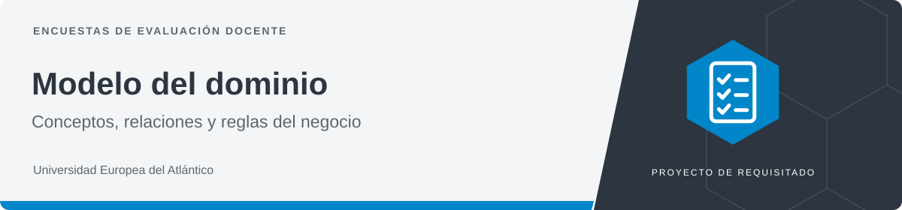
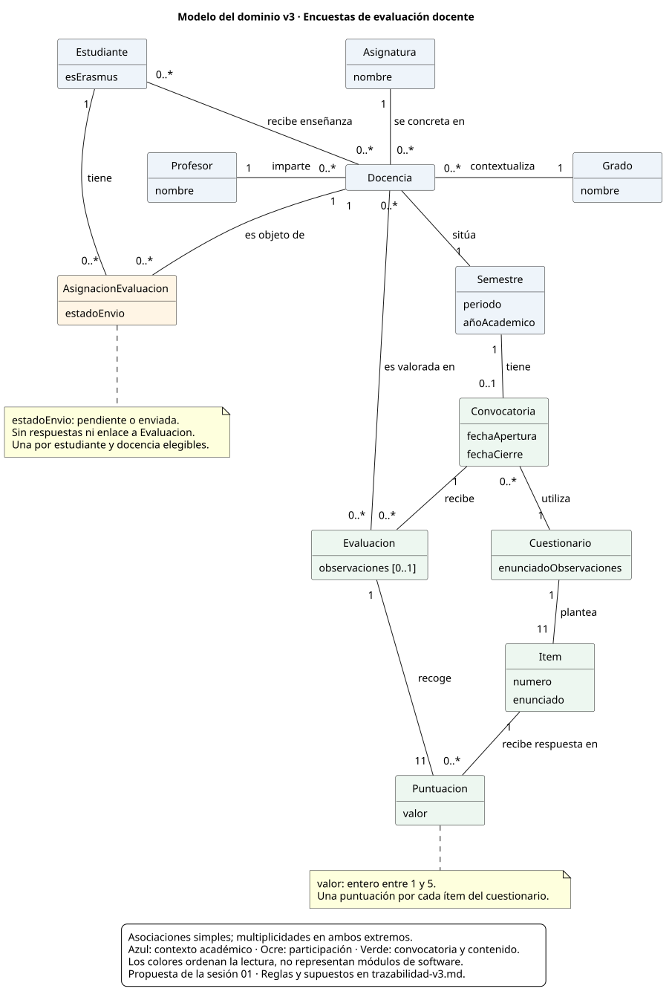

<p align="center">
  
</p>

<p align="center">
<a href="../../README.md"></a>
<a href="../../documentos/sesiones/README.md"></a>
<a href="../../documentos/modelos/README.md"></a>
<a href="../../documentos/casos-uso/README.md"></a>
<a href="../../documentos/modelos/documentacion/glosario.md"></a>
<a href="../../documentos/AI-uso.md"></a>
</p>

# Modelo del dominio · Guía de lectura

El modelo del dominio v3 describe los conceptos y reglas de las encuestas. Está documentado y pendiente de validación con el cliente. Las versiones v1 y v2 se conservan para consulta histórica.

<details>
<summary>En esta página</summary>

- <a href="#vista-del-modelo"></a> Vista del modelo
- <a href="#organización-de-la-carpeta"></a> Organización de la carpeta
- <a href="#orden-de-lectura"></a> Orden de lectura
- <a href="#ir-directamente-a-lo-que-buscas"></a> Ir directamente a lo que buscas
- <a href="#qué-significan-las-referencias"></a> Qué significan las referencias

</details>

## Vista del modelo

<a href="diagramas/clases/clases.svg"></a>

<a href="documentacion/dominio-v3.md"></a> <a href="diagramas/clases/clases.svg"></a> <a href="diagramas/clases/clases.puml"></a>

## Organización de la carpeta

```text
modelos/
├── README.md                 Guía de lectura y accesos
├── documentacion/            Modelo v3, glosario, escenarios y reglas
├── diagramas/                Diagramas de v3: fuente PUML e imagen SVG juntas
│   ├── clases/
│   ├── objetos/
│   └── actividad/
├── seguimiento/              Evolución del modelo y acceso al registro central de IA
└── historico/                Versiones anteriores, conservadas sin cambios
    ├── v1/
    └── v2/
```

La propuesta actual se consulta en `documentacion/` y `diagramas/`. La comparación con versiones anteriores y el registro de trabajo están en `seguimiento/`; los archivos de v1 y v2 se reservan para consulta histórica.

## Orden de lectura

| Paso | Documento | Para qué leerlo | Acceso |
| :--- | :--- | :--- | :--- |
| 1 | Modelo del dominio v3 | Entender las clases, sus relaciones y cómo se envía una evaluación. Es el documento principal. | <a href="documentacion/dominio-v3.md"></a> |
| 2 | Glosario | Consultar qué significa cada concepto, especialmente Docencia, AsignacionEvaluacion y Evaluacion. | <a href="documentacion/glosario.md"></a> |
| 3 | Escenarios con objetos | Ver dos ejemplos concretos: una sustitución y respuestas separadas por grado. | <a href="documentacion/escenarios-v3.md"></a> |
| 4 | Reglas y decisiones | Comprobar de dónde sale cada regla y cómo se representa en el modelo. | <a href="documentacion/trazabilidad-v3.md"></a> |
| 5 | Evolución y referencias | Entender qué cambia respecto a v1/v2 y qué aportan los trabajos anteriores. | <a href="seguimiento/evolucion.md"></a> |
| 6 | Uso de IA | Consultar el registro de asistencia con IA, incluida la entrada de v3. | <a href="../AI-uso.md#modelo-del-dominio-v3"></a> |

Para una primera revisión visual, lee **Modelo → Escenarios** y abre el glosario cuando aparezca un término poco claro. Para revisar la justificación, continúa con **Reglas y decisiones → Evolución**.

## Ir directamente a lo que buscas

| Quiero…                                                   | Ir a…                                                                                                                                                                                             |
| --------------------------------------------------------- | ------------------------------------------------------------------------------------------------------------------------------------------------------------------------------------------------- |
| Ver las clases y sus relaciones.                          | [Diagrama y explicación](documentacion/dominio-v3.md#clases-conceptuales) · [SVG ampliable](diagramas/clases/clases.svg) · [PUML](diagramas/clases/clases.puml).                                  |
| Entender los números de las relaciones.                   | [Asociaciones y multiplicidades](documentacion/dominio-v3.md#asociaciones-y-multiplicidades).                                                                                                     |
| Ver qué pasa al enviar o abandonar.                       | [Envío y conservación](documentacion/dominio-v3.md#envío-y-conservación) · [Actividad en SVG](diagramas/actividad/actividad.svg) · [PUML](diagramas/actividad/actividad.puml).                    |
| Ver el ejemplo de sustitución.                            | [Escenario E-01](documentacion/escenarios-v3.md#e-01--dos-asignaturas-sustitución-y-abandono) · [Objetos en SVG](diagramas/objetos/objetos-01.svg) · [PUML](diagramas/objetos/objetos-01.puml).   |
| Ver el ejemplo de respuestas por grado.                   | [Escenario E-02](documentacion/escenarios-v3.md#e-02--contenido-anónimo-y-separación-por-grado) · [Objetos en SVG](diagramas/objetos/objetos-02.svg) · [PUML](diagramas/objetos/objetos-02.puml). |
| Consultar una regla RN o una decisión S.                  | [Reglas del negocio](documentacion/trazabilidad-v3.md#reglas-del-negocio) · [Decisiones propuestas](documentacion/trazabilidad-v3.md#decisiones-propuestas-y-restricciones-de-consistencia).      |
| Revisar situaciones que el modelo debe admitir o impedir. | [Comprobaciones de consistencia](documentacion/escenarios-v3.md#comprobaciones-de-consistencia).                                                                                                  |
| Comparar con las versiones anteriores.                    | [Versiones y archivos históricos](seguimiento/evolucion.md#versiones-y-evidencia) · [Explicación de los cambios](seguimiento/evolucion.md#revisión-de-v1-y-v2).                                   |
| Volver a lo que dijo el cliente.                          | [Minuta de la sesión 01](../sesiones/sesion01.md#notas-de-la-sesión-del-26-10-2026).                                                                                                              |

## Qué significan las referencias

El número identifica una entrada concreta; no indica importancia ni orden de ejecución. Son referencias de documentación, no símbolos de UML.

| Prefijo                                                                                                                                           | Significado                                                                                       | Dónde se define                                                                                                  |
| ------------------------------------------------------------------------------------------------------------------------------------------------- | ------------------------------------------------------------------------------------------------- | ---------------------------------------------------------------------------------------------------------------- |
| **[RN-01](documentacion/trazabilidad-v3.md#rn-01 "Regla de negocio 01"), [RN-02](documentacion/trazabilidad-v3.md#rn-02 "Regla de negocio 02")…** | Regla de negocio recogida en la minuta.                                                           | [Reglas del negocio](documentacion/trazabilidad-v3.md#reglas-del-negocio).                                       |
| **[S-01](documentacion/trazabilidad-v3.md#s-01 "Decisión propuesta 01"), [S-02](documentacion/trazabilidad-v3.md#s-02 "Decisión propuesta 02")…** | Decisión o supuesto propuesto para representar el dominio; no equivale a un requisito confirmado. | [Decisiones propuestas](documentacion/trazabilidad-v3.md#decisiones-propuestas-y-restricciones-de-consistencia). |
| **[E-01](documentacion/escenarios-v3.md#e-01 "Escenario 01"), [E-02](documentacion/escenarios-v3.md#e-02 "Escenario 02")**                        | Escenario de ejemplo con datos ficticios.                                                         | [Escenarios](documentacion/escenarios-v3.md).                                                                    |
| **[C-01](documentacion/escenarios-v3.md#c-01 "Comprobación 01"), [C-02](documentacion/escenarios-v3.md#c-02 "Comprobación 02")…**                 | Comprobación de consistencia del modelo.                                                          | [Comprobaciones](documentacion/escenarios-v3.md#comprobaciones-de-consistencia).                                 |

Los documentos de v3 tienen enlaces de navegación al principio y al final. Los históricos se consultan desde Evolución y conservan su contenido original.

---

<p align="center">
<a href="../../README.md"></a>
<a href="../../documentos/CONVENCIONES.md"></a>
<a href="../../documentos/AI-uso.md"></a>
<a href="#"></a>
</p>

<p align="center"><sub>Ingeniería del Software I · UNEATLANTICO · 2026–2027</sub></p>
