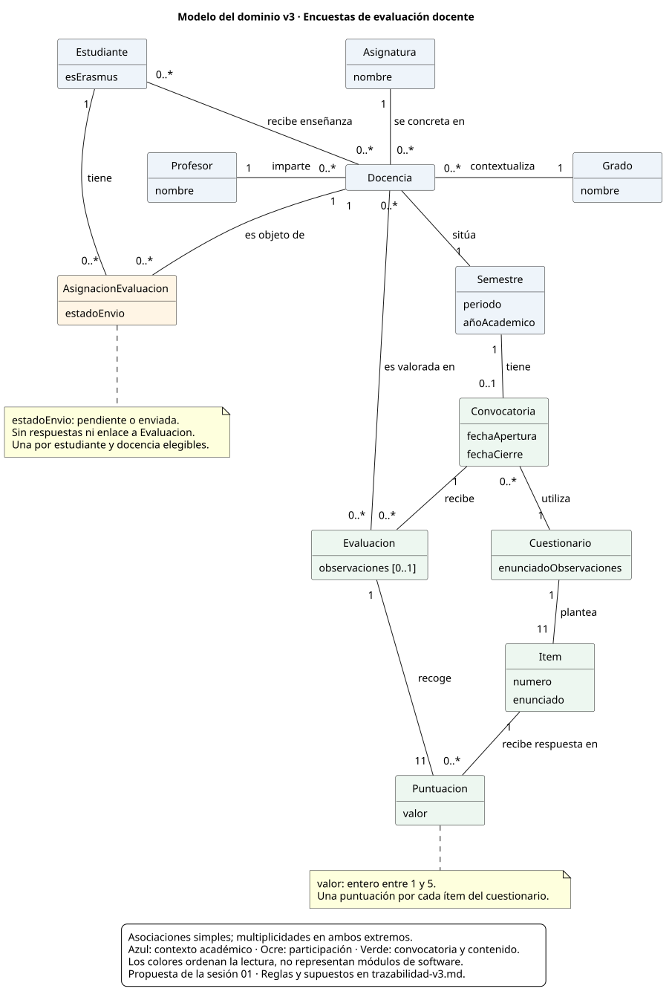
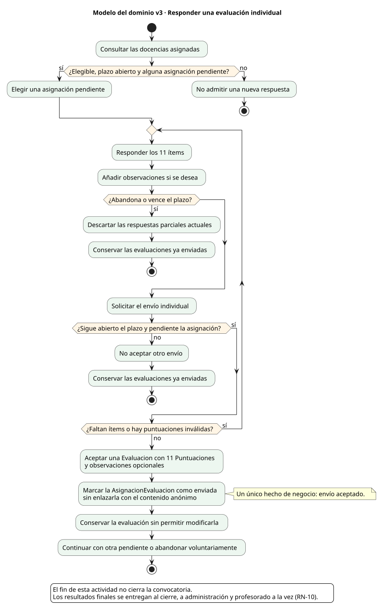

# Modelo del dominio · v3

[Índice del modelo](../README.md) · [Glosario →](glosario.md)

Propuesta del 20/11/2026, basada en la reunión celebrada: [sesión 01, 26/10/2026](../../sesiones/sesion01.md). Trabajo del [issue #16](https://github.com/Raultascon/26-27-IdSw1-SDR/issues/16), acordado en la [discussion #14](https://github.com/Raultascon/26-27-IdSw1-SDR/discussions/14).

## Alcance y lectura

El modelo describe las encuestas de evaluación del profesorado por estudiantes: a quién se evalúa, qué se pregunta, qué respuesta se conserva y cómo se distingue su contexto académico. Es una propuesta conceptual basada en la primera sesión.

La estructura se expresa en el siguiente diagrama de clases conceptuales. Los [escenarios con objetos](escenarios-v3.md) concretan dos situaciones y el diagrama de actividad explica el envío individual. El [glosario](glosario.md) fija el vocabulario, la [trazabilidad](trazabilidad-v3.md) relaciona las reglas con la minuta y la [evolución](../seguimiento/evolucion.md) permite contrastar v1, v2 y v3 y las referencias consultadas.

## Clases conceptuales

[Fuente PlantUML](../diagramas/clases/clases.puml).

La lectura sigue tres grupos de color: contexto académico (azul), participación (ocre) y convocatoria con contenido anónimo (verde). Los colores solo agrupan conceptos para facilitar la lectura; no son componentes ni capas de software.

**Docencia** reúne a un profesor, una asignatura, un grado y un semestre. Dos profesores en una asignatura dan lugar a dos docencias; un profesor en dos asignaturas, también. Las docencias de quien impartió al principio y de quien lo sustituyó permanecen separadas. No se confunde la asignatura del catálogo con su impartición en un semestre.

**AsignacionEvaluacion** expresa que un estudiante tiene pendiente o ya ha enviado la evaluación de una docencia. Permite razonar sobre personalización, recordatorios y ausencia de reenvío. **Evaluacion** recoge exclusivamente el contenido anónimo aceptado. No hay asociación entre ambas ni entre Evaluacion y Estudiante. Docencia y Convocatoria son contextos compartidos: sus asociaciones permiten conocer a los posibles participantes, pero no identifican al autor de una respuesta concreta.

El cuestionario de una asignación se determina mediante el recorrido **AsignacionEvaluacion → Docencia → Semestre → Convocatoria → Cuestionario**. Como hay una sola convocatoria por semestre y un cuestionario por convocatoria, no hace falta una asociación directa adicional con Cuestionario. Las asignaciones se crean al preparar la convocatoria: no pueden existir para un semestre que todavía carezca de ella ([S-02](trazabilidad-v3.md#s-02 "Decisión propuesta 02")). Una Evaluacion obtiene su cuestionario mediante **Evaluacion → Convocatoria → Cuestionario**.

Vincular una asignación con una Evaluacion concreta permitiría recorrer **Estudiante → AsignacionEvaluacion → Evaluacion** e identificar qué respuestas envió ese estudiante. Por eso el envío cambia el estado de la asignación y conserva el contenido anónimo sin mantener ese vínculo ([RN-03](trazabilidad-v3.md#rn-03 "Regla de negocio 03")). Vincularla con la plantilla común no identificaría las respuestas, pero repetiría información ya determinada por el recorrido anterior.

El modelo describe la separación conceptual entre participación y contenido; esta separación por sí sola no garantiza el anonimato frente a inferencias ([C-05](escenarios-v3.md#c-05 "Comprobación 05")). No se diseñan identificadores, sesiones, credenciales ni almacenamiento en esta propuesta.

## Asociaciones y multiplicidades

La multiplicidad se interpreta en el extremo junto al que aparece. `0..*` permite preparar catálogos, no haber recibido respuestas o no participar; no obliga a una persona a responder.

| Asociación | Lectura y justificación |
| --- | --- |
| Profesor — Docencia | Cada docencia tiene 1 profesor; un profesor puede tener 0..* docencias. Se representa por separado a cada profesor que impartió clase ([RN-02](trazabilidad-v3.md#rn-02 "Regla de negocio 02")). |
| Asignatura — Docencia | Cada docencia corresponde a 1 asignatura; una asignatura puede aparecer en 0..* docencias de distintos profesores y periodos ([RN-02](trazabilidad-v3.md#rn-02 "Regla de negocio 02")). |
| Grado — Docencia | Cada docencia se contextualiza en 1 grado; un grado tiene 0..* docencias. Se propone separar contextos para obtener resultados por grado ([S-01](trazabilidad-v3.md#s-01 "Decisión propuesta 01")). |
| Semestre — Docencia | Cada docencia ocurre en 1 semestre; un semestre tiene 0..* docencias. La asignatura no queda ligada para siempre a ese semestre ([S-01](trazabilidad-v3.md#s-01 "Decisión propuesta 01")). |
| Estudiante — Docencia | Un estudiante recibe enseñanza en 0..* docencias; una docencia puede tener 0..* estudiantes. Incluye estudiantes Erasmus, aunque no reciben asignaciones de evaluación ([RN-01](trazabilidad-v3.md#rn-01 "Regla de negocio 01")). |
| Estudiante — AsignacionEvaluacion | Cada asignación corresponde a 1 estudiante; un estudiante tiene 0..* asignaciones. No contiene respuestas ([RN-03](trazabilidad-v3.md#rn-03 "Regla de negocio 03"), [S-02](trazabilidad-v3.md#s-02 "Decisión propuesta 02")). |
| Docencia — AsignacionEvaluacion | Cada asignación se refiere a 1 docencia; una docencia tiene 0..* asignaciones. Solo se asignan docencias recibidas por estudiantes elegibles ([RN-01](trazabilidad-v3.md#rn-01 "Regla de negocio 01"), [RN-02](trazabilidad-v3.md#rn-02 "Regla de negocio 02")). |
| Semestre — Convocatoria | Cada convocatoria es de 1 semestre; un semestre tiene 0..1 convocatoria mientras se prepara, y 1 cuando se realiza la campaña prevista. No se contemplan convocatorias extraordinarias ([RN-08](trazabilidad-v3.md#rn-08 "Regla de negocio 08")). |
| Convocatoria — Cuestionario | Cada convocatoria utiliza 1 cuestionario común; un cuestionario puede reutilizarse en 0..* convocatorias. La reutilización es una posibilidad de modelado, no una exigencia del cliente ([S-03](trazabilidad-v3.md#s-03 "Decisión propuesta 03")). |
| Cuestionario — Item | Cada cuestionario plantea exactamente 11 ítems; cada ítem pertenece a 1 cuestionario. Sus números son distintos y van de 1 a 11 ([RN-04](trazabilidad-v3.md#rn-04 "Regla de negocio 04")). |
| Convocatoria — Evaluacion | Cada evaluación aceptada pertenece a 1 convocatoria; una convocatoria recibe 0..* evaluaciones por la participación voluntaria ([RN-03](trazabilidad-v3.md#rn-03 "Regla de negocio 03")). |
| Docencia — Evaluacion | Cada evaluación valora 1 docencia; una docencia recibe 0..* evaluaciones anónimas. Su semestre debe coincidir con el de la convocatoria ([RN-02](trazabilidad-v3.md#rn-02 "Regla de negocio 02"), [S-01](trazabilidad-v3.md#s-01 "Decisión propuesta 01")). |
| Evaluacion — Puntuacion | Cada evaluación aceptada recoge exactamente 11 puntuaciones; cada puntuación pertenece a 1 evaluación. Una respuesta a medio rellenar no es una Evaluacion conservada ([RN-05](trazabilidad-v3.md#rn-05 "Regla de negocio 05")). |
| Item — Puntuacion | Cada puntuación responde a 1 ítem; un ítem puede recibir 0..* puntuaciones. Los ítems deben ser los del cuestionario de la convocatoria y no repetirse en una evaluación ([RN-04](trazabilidad-v3.md#rn-04 "Regla de negocio 04")). |

## Atributos del modelo

Se incluyen solo atributos con significado para la primera sesión: nombres de conceptos académicos, condición Erasmus, periodo, fechas, enunciados, estado de envío, valor y observaciones. No se añaden datos de relleno para llegar a un número mínimo. **Docencia** no necesita atributos propios en esta versión: se define mediante sus cuatro asociaciones académicas.

## Cuestionario y resultados

Los enunciados normativos son los de la [tabla de ítems de la minuta](../../sesiones/sesion01.md#detalle-de-los-ítems-del-cuestionario). Los once ítems numéricos son obligatorios para enviar cada evaluación, con valores enteros entre 1 y 5. No se inventan etiquetas como «muy de acuerdo», porque no constan en la minuta. La pregunta abierta se expresa como `Cuestionario.enunciadoObservaciones` y su respuesta como `Evaluacion.observaciones [0..1]`.

Las medias, el número de valoraciones y los comentarios son información derivada de las evaluaciones, sin clases de informes ni de exportación. Para cada combinación de **convocatoria, profesor, asignatura y grado** se obtiene el conjunto de evaluaciones correspondiente. Esta agrupación conserva la independencia pedida para cada asignatura y grado.

Según la propuesta [S-04](trazabilidad-v3.md#s-04 "Decisión propuesta 04"), si ese conjunto tiene `N > 0` evaluaciones, el cálculo es:

- Número de valoraciones: `N` (número de evaluaciones, no número de puntuaciones).
- Media del ítem `j`: suma de las `N` puntuaciones del ítem `j`, dividida por `N`.
- Media global: media aritmética de las 11 medias por ítem, equivalente a promediar las `11 × N` puntuaciones, antes de redondear.
- Comentarios: observaciones presentes en esas evaluaciones, sin identificación del estudiante.

La **media del ítem 11, «Valoración global del profesor»**, se obtiene únicamente de las puntuaciones de esa pregunta. La **media global calculada** resume las puntuaciones de los once ítems según [S-04](trazabilidad-v3.md#s-04 "Decisión propuesta 04"). Son dos resultados distintos y pueden tener valores diferentes.

Con `N = 0`, el número de valoraciones es cero y las medias no tienen valor; no se dividen entre cero ni se representan como una puntuación cero ([C-06](escenarios-v3.md#c-06 "Comprobación 06")).

## Envío y conservación

[Fuente PlantUML](../diagramas/actividad/actividad.puml).

El diagrama se limita a una evaluación individual. Si un envío contiene errores, se completan o corrigen las respuestas durante la misma sesión sin descartarlas. Una asignación pendiente puede abandonarse y retomarse empezando de nuevo; sus respuestas parciales no se conservan. El envío aceptado conserva las once puntuaciones y marca la asignación como enviada, sin enlazar participación y contenido. No hay modificación ni segundo envío. Las evaluaciones anteriores permanecen si se abandona el resto.

El cierre de convocatoria es independiente del final de esta actividad. Los resultados finales se entregan al administrador y al profesorado al mismo tiempo después del cierre.

---

[Índice del modelo](../README.md) · [Glosario →](glosario.md) · [Volver arriba](#modelo-del-dominio--v3)
