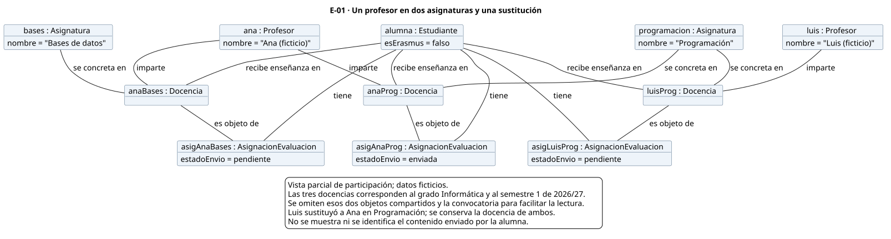
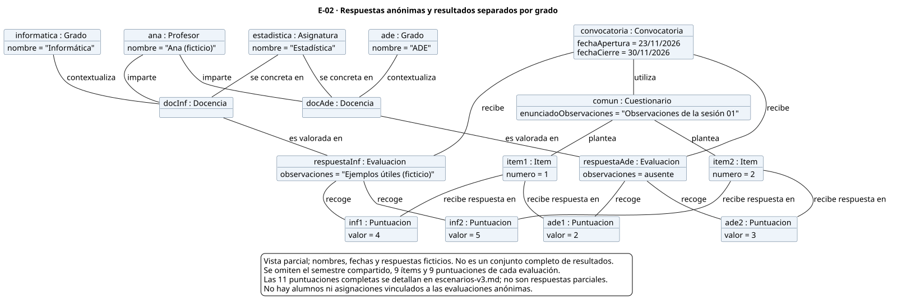

# Escenarios y comprobación del modelo · v3

[Índice del modelo](../README.md) · [← Glosario](glosario.md) · [Reglas y decisiones →](trazabilidad-v3.md)

Complemento del [modelo conceptual](dominio-v3.md) y sus [reglas](trazabilidad-v3.md). Los nombres, valores y fechas son **datos ficticios**, no hechos obtenidos del cliente. Cada diagrama es una vista parcial de un mismo tipo de estructura: omitir un objeto para facilitar la lectura no elimina las multiplicidades del modelo.

## E-01 · Dos asignaturas, sustitución y abandono

[Fuente PlantUML](../diagramas/objetos/objetos-01.puml).

Una estudiante no Erasmus recibió clase de Ana en Programación y Bases de datos, y de Luis cuando sustituyó a Ana en Programación. Las tres docencias están en Informática, semestre 1 de 2026/27, con una convocatoria común. Los objetos Grado, Semestre y Convocatoria se omiten en esta vista; los tres contextos académicos están completos en el escenario.

Tiene tres asignaciones distintas. Tras enviar la de Ana–Programación y abandonar a mitad de Ana–Bases de datos:

- `asigAnaProg.estadoEnvio = enviada`; no permite modificar ni reenviar.
- `asigAnaBases.estadoEnvio = pendiente`; sus respuestas parciales se descartan.
- `asigLuisProg.estadoEnvio = pendiente`; la sustitución no elimina la evaluación de Ana.

La evaluación ya aceptada se conserva, pero no se dibuja una respuesta concreta como propiedad de esta estudiante. La vista de participación solo acredita el estado de envío. Mientras la convocatoria esté abierta quedan pendientes y continúa el aviso del campus; cerrada la convocatoria, cesa aunque no se hayan respondido.

Este escenario cubre RN-01, RN-02, RN-05, RN-06 y RN-09. Si Ana volviera a impartir la misma asignatura durante ese semestre, S-01 propone mantener una sola docencia para la misma combinación.

## E-02 · Contenido anónimo y separación por grado

[Fuente PlantUML](../diagramas/objetos/objetos-02.puml).

Ana imparte Estadística en Informática y en ADE durante el semestre 1 de 2026/27. Son dos docencias diferentes con el mismo profesor y asignatura. La convocatoria ilustrativa abre el 23/11/2026 y cierra el 30/11/2026; estas fechas no constituyen una planificación real.

La vista muestra dos evaluaciones completas anónimas, una de cada grado, tomadas de un conjunto de participantes no representado. No muestra alumnos ni asignaciones. Los nombres `respuestaInf` y `respuestaAde` son etiquetas de los objetos en el ejemplo, no identificadores de estudiantes.

El cuestionario es el de la sesión 01; sus enunciados se toman literalmente de la minuta. En el dibujo se abrevia el enunciado de observaciones y se omiten los enunciados de ítem para evitar repetir la tabla. Se muestran dos ítems y cuatro puntuaciones; los nueve ítems restantes y sus puntuaciones existen, pero se omiten gráficamente. Las respuestas completas son:

| Evaluación | Ítems 1 a 11, en orden | Observaciones |
| --- | --- | --- |
| respuestaInf | 4, 5, 4, 4, 5, 4, 4, 5, 4, 4, 5 | Ejemplos útiles (ficticio). |
| respuestaAde | 2, 3, 3, 2, 3, 3, 2, 3, 3, 2, 3 | Ausentes. |

Ambas evaluaciones satisfacen RN-04: once valores válidos y un comentario opcional. Las dos comparten Cuestionario y sus ítems, pero no Docencia. El Semestre compartido se omite en el dibujo y debe ser el mismo para docencias y convocatoria.

**Comprobación aritmética aislada:** si cada fila fuera la única respuesta de su grupo, Informática tendría `N = 1`, medias por ítem iguales a su fila y media global `48/11 ≈ 4,36`; ADE tendría `N = 1` y media global `29/11 ≈ 2,64`. No se calcula una media conjunta de ambos grados. Es un ejemplo de la fórmula S-04.

Este escenario cubre RN-03, RN-04 y RN-07. La ausencia de observaciones de ADE es válida; una ausencia de puntuación obligatoria no lo sería.

## Comprobaciones de consistencia

Son criterios de revisión del modelo, no pruebas de una aplicación implementada.

| ID | Situación | Resultado esperado y regla |
| --- | --- | --- |
| C-01 | Estudiante Erasmus que recibe una docencia. | Puede figurar en el contexto académico, pero no recibe AsignacionEvaluacion ni invitación (RN-01). |
| C-02 | Intentar enviar 10 valores, un 0, un 6 o un valor no entero. Repetir un ítem aunque haya 11 puntuaciones. | No existe una Evaluacion aceptada válida hasta que haya 11 ítems distintos del cuestionario con valores enteros de 1 a 5 (RN-04). |
| C-03 | Completar una evaluación y abandonar otra con cinco respuestas. | Permanece la primera; no se conserva la segunda. La asignación de la segunda sigue pendiente, sin borrador persistido (RN-05). |
| C-04 | Reenviar o modificar una asignación enviada. | No se acepta; no se duplica el contenido conservado ni vuelve a pendiente (RN-06, S-02). |
| C-05 | Buscar el autor de una respuesta recorriendo asociaciones. | No existe vínculo de autoría hacia Estudiante ni AsignacionEvaluacion. El contexto académico identifica un conjunto de posibles participantes; no garantiza por sí solo anonimato frente a inferencias (RN-03). |
| C-06 | Mismo profesor en dos asignaturas o grados; convocatoria sin respuestas. | Se mantienen agrupaciones diferentes. Con `N = 0`, la propuesta no divide por cero ni muestra una media cero (RN-07, S-04). |
| C-07 | Envío tras el cierre; estudiante con pendientes al vencer el plazo. | No se admite otro envío ni siguen los avisos. Los resultados finales se hacen disponibles al administrador y profesores al cierre, sin esperar participación completa (RN-08 a RN-10). |
| C-08 | Modificar el cuestionario de una convocatoria abierta o usar un ítem de otra plantilla. | Incompatible con la plantilla fija y con la restricción de correspondencia entre evaluación, convocatoria y sus once ítems (RN-04). |

---

[Índice del modelo](../README.md) · [← Glosario](glosario.md) · [Reglas y decisiones →](trazabilidad-v3.md) · [Volver arriba](#escenarios-y-comprobación-del-modelo--v3)
