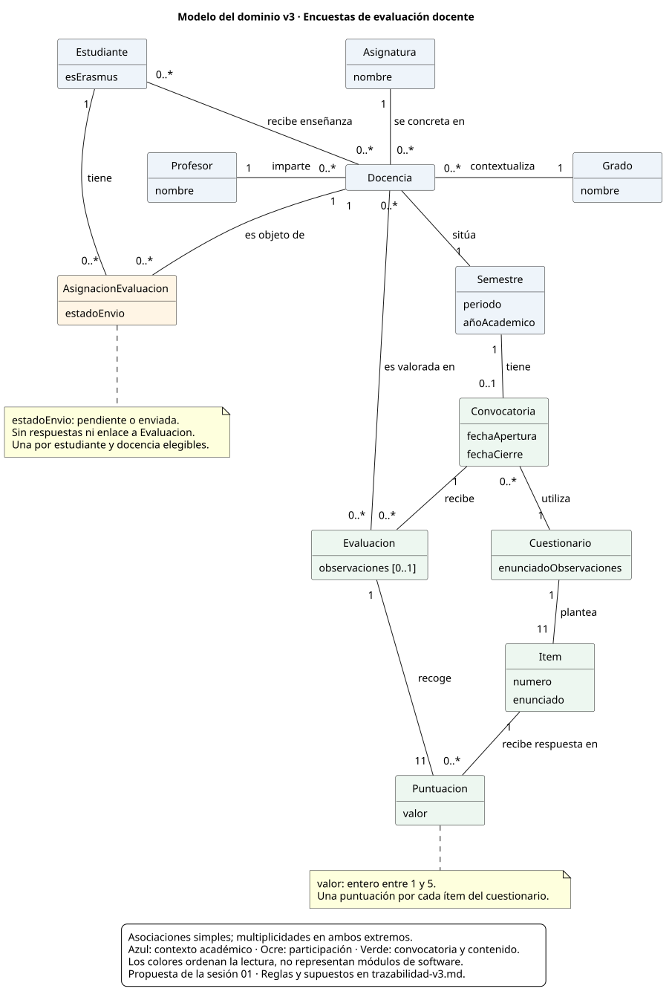
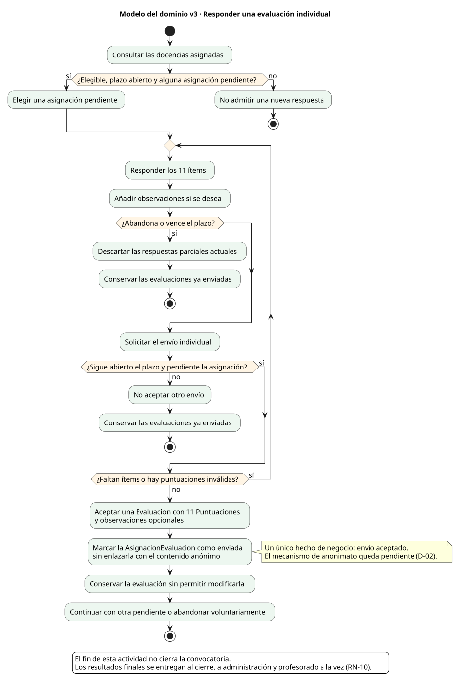

# Modelo del dominio · v3

Propuesta del 20/11/2026, basada en la única reunión celebrada: [sesión 01, 26/10/2026](../sesiones/sesion01.md). Trabajo del [issue #16](https://github.com/Raultascon/26-27-IdSw1-SDR/issues/16), acordado en la [discussion #14](https://github.com/Raultascon/26-27-IdSw1-SDR/discussions/14). **Pendiente de revisión del equipo y validación del cliente.**

## Alcance y lectura

El modelo describe las encuestas de evaluación del profesorado por estudiantes: a quién se evalúa, qué se pregunta, qué respuesta se conserva y cómo se distingue su contexto académico. Es una propuesta conceptual de la primera sesión, abierta a cambios cuando se aclaren las dudas.

La estructura se expresa en el siguiente diagrama de clases conceptuales. Los [escenarios con objetos](escenarios-v3.md) concretan dos situaciones y el diagrama de actividad explica el envío individual. El [glosario](glosario.md) fija el vocabulario, la [trazabilidad](trazabilidad-v3.md) relaciona reglas y dudas con la minuta y la [evolución](evolucion.md) permite contrastar v1, v2 y v3 y las referencias consultadas.

## Clases conceptuales

[Fuente PlantUML](modelosUML/v3/clases.puml).

La lectura sigue tres grupos de color: contexto académico (azul), participación (ocre) y convocatoria con contenido anónimo (verde). Los colores solo agrupan conceptos para facilitar la lectura; no son componentes ni capas de software.

**Docencia** reúne a un profesor, una asignatura, un grado y un semestre. Dos profesores en una asignatura dan lugar a dos docencias; un profesor en dos asignaturas, también. Las docencias de quien impartió al principio y de quien lo sustituyó permanecen separadas. No se confunde la asignatura del catálogo con su impartición en un semestre.

**AsignacionEvaluacion** expresa que un estudiante tiene pendiente o ya ha enviado la evaluación de una docencia. Permite razonar sobre personalización, recordatorios y ausencia de reenvío. **Evaluacion** recoge exclusivamente el contenido anónimo aceptado. No hay asociación entre ambas ni entre Evaluacion y Estudiante. Docencia y Convocatoria son contextos compartidos: sus asociaciones permiten conocer a los posibles participantes, pero no identifican al autor de una respuesta concreta.

Esto no demuestra anonimato técnico. La correlación temporal, los grupos pequeños, los comentarios que contienen nombres y el mecanismo para impedir duplicados necesitan tratamiento posterior (D-02). No se diseñan identificadores, sesiones, credenciales ni almacenamiento en esta propuesta.

## Asociaciones y multiplicidades

La multiplicidad se interpreta en el extremo junto al que aparece. `0..*` permite preparar catálogos, no haber recibido respuestas o no participar; no obliga a una persona a responder.

| Asociación | Lectura y justificación |
| --- | --- |
| Profesor — Docencia | Cada docencia tiene 1 profesor; un profesor puede tener 0..* docencias. Se representa por separado a cada profesor que impartió clase (RN-02). |
| Asignatura — Docencia | Cada docencia corresponde a 1 asignatura; una asignatura puede aparecer en 0..* docencias de distintos profesores y periodos (RN-02). |
| Grado — Docencia | Cada docencia se contextualiza en 1 grado; un grado tiene 0..* docencias. Se propone separar contextos para obtener resultados por grado (S-01, D-03). |
| Semestre — Docencia | Cada docencia ocurre en 1 semestre; un semestre tiene 0..* docencias. La asignatura no queda ligada para siempre a ese semestre (S-01). |
| Estudiante — Docencia | Un estudiante recibe enseñanza en 0..* docencias; una docencia puede tener 0..* estudiantes. Incluye estudiantes Erasmus, aunque no reciben asignaciones de evaluación (RN-01). |
| Estudiante — AsignacionEvaluacion | Cada asignación corresponde a 1 estudiante; un estudiante tiene 0..* asignaciones. No contiene respuestas (RN-03, S-02). |
| Docencia — AsignacionEvaluacion | Cada asignación se refiere a 1 docencia; una docencia tiene 0..* asignaciones. Solo se asignan docencias recibidas por estudiantes elegibles (RN-01, RN-02). |
| Semestre — Convocatoria | Cada convocatoria es de 1 semestre; un semestre tiene 0..1 convocatoria mientras se prepara, y 1 cuando se realiza la campaña prevista. No se contemplan convocatorias extraordinarias (RN-08). |
| Convocatoria — Cuestionario | Cada convocatoria utiliza 1 cuestionario común; un cuestionario puede reutilizarse en 0..* convocatorias. La reutilización es una posibilidad de modelado, no una exigencia del cliente (S-03). |
| Cuestionario — Item | Cada cuestionario plantea exactamente 11 ítems; cada ítem pertenece a 1 cuestionario. Sus números son distintos y van de 1 a 11 (RN-04). |
| Convocatoria — Evaluacion | Cada evaluación aceptada pertenece a 1 convocatoria; una convocatoria recibe 0..* evaluaciones por la participación voluntaria (RN-03). |
| Docencia — Evaluacion | Cada evaluación valora 1 docencia; una docencia recibe 0..* evaluaciones anónimas. Su semestre debe coincidir con el de la convocatoria (RN-02, S-01). |
| Evaluacion — Puntuacion | Cada evaluación aceptada recoge exactamente 11 puntuaciones; cada puntuación pertenece a 1 evaluación. Una respuesta a medio rellenar no es una Evaluacion conservada (RN-05). |
| Item — Puntuacion | Cada puntuación responde a 1 ítem; un ítem puede recibir 0..* puntuaciones. Los ítems deben ser los del cuestionario de la convocatoria y no repetirse en una evaluación (RN-04). |

## Atributos, jerarquía y visibilidad

Se incluyen solo atributos con significado para la primera sesión: nombres de conceptos académicos, condición Erasmus, periodo, fechas, enunciados, estado de envío, valor y observaciones. No se añaden datos de relleno para llegar a un número mínimo. **Docencia** no necesita atributos propios en esta versión: se define mediante sus cuatro asociaciones académicas.

La jerarquía es documental y visual. No se introducen herencias: ser profesor fijo o sustituto no cambia la estructura de su evaluación; ser Erasmus se expresa mediante una condición de elegibilidad. Tampoco se usan agregación ni composición en v3.

No se añaden signos de acceso `+`, `-` o `#` a los atributos: su visibilidad pública o privada corresponde al diseño de software. La visibilidad de información del negocio sí queda definida: el estudiante responde, el administrador puede consultar todas las respuestas y cada profesor recibe sus resultados al cierre. La ausencia de signos UML de acceso no hace públicos los datos.

## Cuestionario y resultados

Los enunciados normativos son los de la [tabla de ítems de la minuta](../sesiones/sesion01.md#detalle-de-los-ítems-del-cuestionario). Los once ítems numéricos son obligatorios para enviar cada evaluación, con valores enteros entre 1 y 5. No se inventan etiquetas como «muy de acuerdo», porque no constan en la minuta. La pregunta abierta se expresa como `Cuestionario.enunciadoObservaciones` y su respuesta como `Evaluacion.observaciones [0..1]`.

Las medias, el número de valoraciones y los comentarios son información derivada de las evaluaciones, sin clases de informes ni de exportación. Para cada combinación de **convocatoria, profesor, asignatura y grado** se obtiene el conjunto de evaluaciones correspondiente. Esta agrupación conserva la independencia pedida para cada asignatura y grado; el modo de presentar un total por profesor queda pendiente (D-04).

Si ese conjunto tiene `N > 0` evaluaciones, la propuesta de cálculo es:

- Número de valoraciones: `N` (número de evaluaciones, no número de puntuaciones).
- Media del ítem `j`: suma de las `N` puntuaciones del ítem `j`, dividida por `N`.
- Media global: media aritmética de las 11 medias por ítem, equivalente a promediar las `11 × N` puntuaciones, antes de redondear.
- Comentarios: observaciones presentes en esas evaluaciones, sin identificación del estudiante.

La existencia de esas medias está confirmada; la fórmula global, el redondeo y la presentación sin respuestas son propuestas pendientes de confirmación (S-04, D-04). Con `N = 0` se propone mostrar «sin valoraciones» y dejar las medias sin valor, nunca poner cero ni dividir por cero.

## Envío y conservación

[Fuente PlantUML](modelosUML/v3/actividad.puml).

El diagrama se limita a una evaluación individual. Una asignación pendiente puede abandonarse y retomarse empezando de nuevo; sus respuestas parciales no se conservan. El envío aceptado conserva las once puntuaciones y marca la asignación como enviada, sin enlazar participación y contenido. No hay modificación ni segundo envío. Las evaluaciones anteriores permanecen si se abandona el resto.

El cierre de convocatoria es independiente del final de esta actividad. Los resultados finales se entregan al administrador y al profesorado al mismo tiempo después del cierre (RN-10). Los recordatorios se describen en RN-09; no es necesario convertirlos en una entidad persistente.

## Límites de esta entrega

El administrador único, las notificaciones por campus y correo, las exportaciones PDF/Excel y la integración simulada con Panal/campus se conservan como reglas o capacidades en la trazabilidad. No se pierde el requisito por no dibujar una clase para cada acción o pantalla. Los actores y casos de uso corresponden al [issue #15](https://github.com/Raultascon/26-27-IdSw1-SDR/issues/15).

La propuesta queda preparada para revisión con dos escenarios, fuentes editables, imágenes y reglas verificables. No se declara validación del cliente ni se resuelven por suposición las preguntas abiertas de la minuta.
