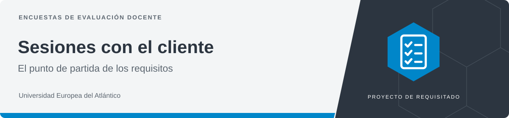
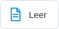

  

# Sesiones con el cliente

La minuta es la fuente de las necesidades expresadas por el cliente. Los modelos y casos de uso enlazan con ella para justificar sus reglas y señalar las cuestiones pendientes.

En esta página

-  Sesiones documentadas
-  Consultar la sesión 01
-  Trabajo derivado

## Sesiones documentadas

| Sesión | Fecha | Temas tratados | Minuta |
| :--- | :--- | :--- | :--- |
| 01 | 26/10/2026 | Objetivos, elegibilidad, cuestionario, convocatoria, resultados e integración. |  |

## Consultar la sesión 01

| Contenido | Acceso |
| :--- | :--- |
| Preguntas de preparación de la reunión |  |
| Notas y acuerdos recogidos |  |
| Los 11 ítems y las observaciones del cuestionario |  |

## Trabajo derivado

| Artefacto | Relación con la minuta | Acceso |
| :--- | :--- | :--- |
| Reglas y decisiones del dominio | Distingue reglas del negocio y supuestos propuestos para modelarlas. |  |
| Actores y casos de uso | Describe interacciones e identifica propuestas pendientes de validar. |  |

**Seguimiento:** la preparación de la minuta se vincula al [issue #10](https://github.com/Raultascon/26-27-IdSw1-SDR/issues/10). Las nuevas aclaraciones del cliente se registran en issues o Discussions y se enlazan desde el artefacto afectado.

---

Ingeniería del Software I · UNEATLANTICO · 2026–2027

